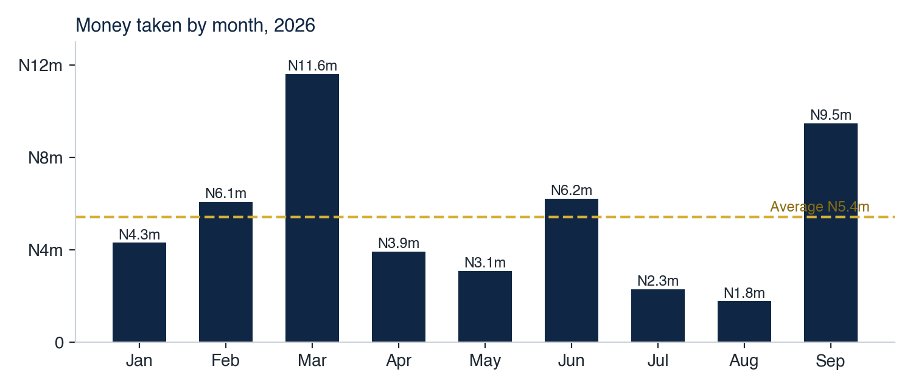
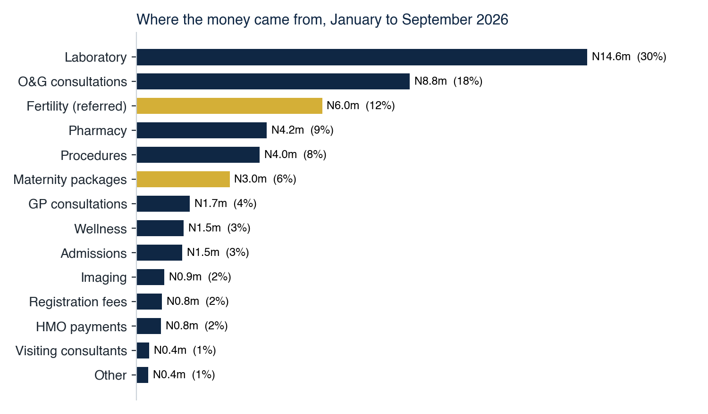
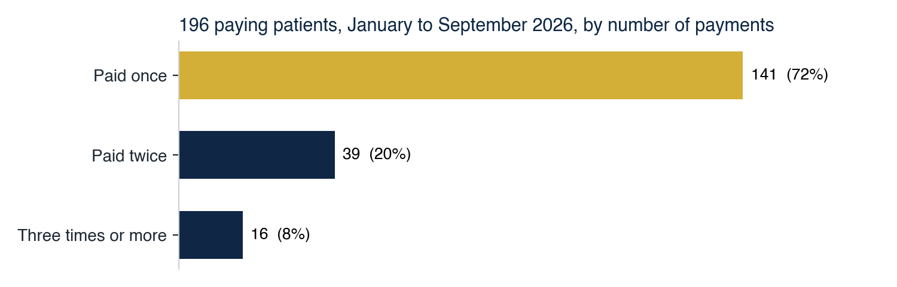
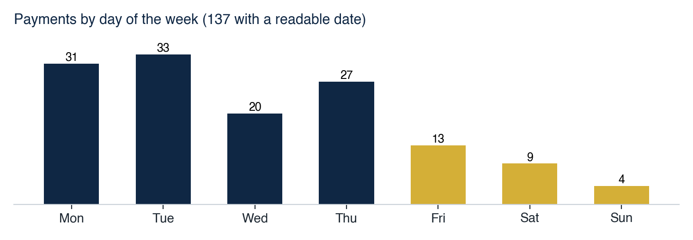
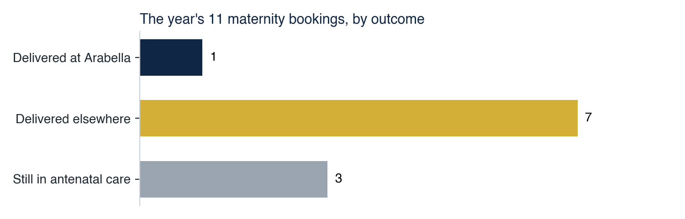
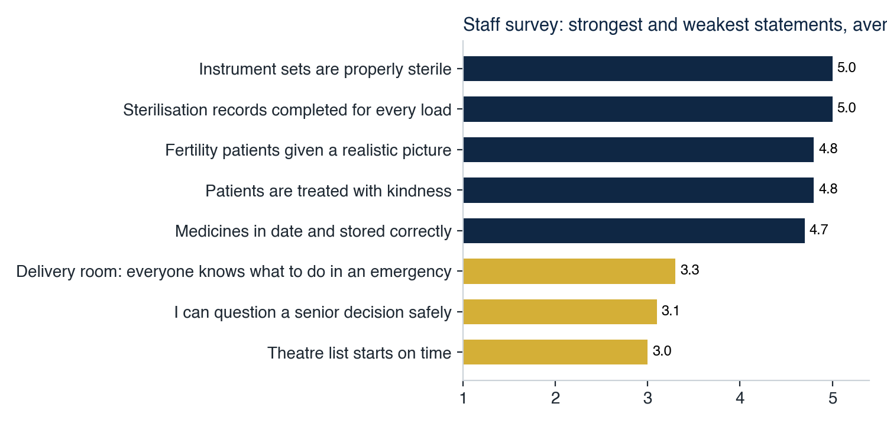
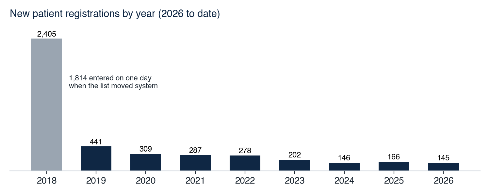

# Arabella Women's Health

**Diagnostic Audit: Findings and Recommendations**

Prepared by Dr Debo Odulana, Founding Partner, Consult for Africa
For Dr Chito Nwana, Arabella Women's Health
Issued 27 October 2026  /  Evidence received to 21 October 2026

---

## A letter before the report

Dr Chito, thank you, and Tolu, for how much you have sent us. Twenty four uploads, statements from two banks and two thoughtful leadership answers in three weeks is more than most clients manage.

When we started you asked for a clear and objective picture of where Arabella stands, and for three things in particular: what needs immediate attention, what can wait, and what you should strengthen before expanding further. This report is the full analysis behind those answers, with a recommendation, an owner and a date against each one. A shorter interim report is already in your portal. This one shows the working.

A few things I want to say plainly up front.

The first is that Arabella is a sound practice. Your team rates patient safety highly, your laboratory is properly run and properly licensed, your patient list is real and large, and the staff who answered us like how patients are treated. That is the foundation, and nothing that follows takes away from it.

The second is that the plan you were given leads on maternity, surgery and fertility, and the records show those are not yet where the business earns. Today Arabella earns from its laboratory and its consultations. I do not think that is a reason to abandon the plan. I think it is a reason to fix conversion and cost first, and to expand second.

The third is the facility registration. The only registration we have seen is for Tabitha at Jabi, and the 2026 renewal was paid but has not yet been granted. I would like to put this right with you in the next fortnight, before it becomes anyone else's question.

Some of what we asked for has not yet arrived, most importantly the patient and referrer surveys. Where that limits a conclusion, the report says so. Section 11 lists each gap and what it would change.

The natural next step is a one hour session with you and Tolu to agree the owners and dates in section 10. I will make the time whenever suits you.

Warm regards,
Dr Debo Odulana

---

## 1. The answer in one page

- Revenue: N48.7m taken January to September 2026, about N5.4m a month, from about 26 paying patients a month. You and Tolu both put it at N5m to N8m, so the baseline is agreed.
- What the business is today: a laboratory and consultation practice. The laboratory is 30% of receipts and consultations 22%. Maternity packages are 6%.
- The constraint: conversion and cost. Patients arrive and do not stay. 7 in 10 pay once, and 7 of the year's 11 maternity bookings delivered elsewhere.
- Cost: January to July operating cost of about N40.0m ran slightly above revenue of N37.4m, while N24.8m went into the Asokoro renovation. From July two salary rolls ran together.
- Cash: neither First Bank account held a working balance on 2 October 2026.
- Compliance: the Asokoro premises needs its own facility registration, the 2026 renewal needs to be granted, and pharmacy sales need a pharmacist and a premises licence.
- People: a team proud of its care that wants more trust to decide. You, Tolu and your staff each named, independently, that too much depends on you.
- Recommendation: put the registration and pharmacy right now, fix conversion, cost and cash over the next quarter, and expand into maternity, surgery and fertility once those hold.

---

## 2. Your three questions, answered

| Your question | Our answer |
|---|---|
| What needs immediate attention | Facility registration for Asokoro and the 2026 renewal decision. A pharmacist and pharmacy premises licence. A cash floor and weekly cash report. Patient confidentiality at the front desk |
| What to strengthen before expanding | Maternity conversion. Follow-up booking. One cost base instead of two. Delegated authority. Insurer income. Mobile numbers on the patient list |
| What can wait | Building an in-house fertility unit. Expanding surgery. Large-scale marketing. Marketing to the full patient list |

Section 10 sets out each recommendation in full.

---

## 3. What Arabella earns

### Receipts by month

| Month 2026 | Taken | Note |
|---|---|---|
| January | N4.29m | |
| February | N6.07m | |
| March | N11.60m | Includes one payment of N6.5m, mostly fertility |
| April | N3.91m | |
| May | N3.08m | |
| June | N6.20m | |
| July | N2.29m | |
| August | N1.77m | |
| September | N9.48m | Includes one procedure payment of N2.0m and the first admissions recorded |
| Total | N48.69m | 285 payments |

- Average month: N5.4m, or N4.7m without the single largest payment.
- Typical payment: about N100,000. Half of all payments fall between N50,000 and N185,000.
- Single-payment dependence: without the two large payments, months run between N1.8m and N6.2m. A practice that depends on occasional large cases is hard to plan, staff and stock around.
- Second half: July and August are the two weakest months of the year. The bank statements show the same fall (section 6).

### Receipts by service line, January to September

| Service line | Taken | Share |
|---|---|---|
| Laboratory | N14.56m | 30% |
| O&G consultations | N8.83m | 18% |
| Fertility (referred to a partner laboratory) | N6.00m | 12% |
| Pharmacy | N4.21m | 9% |
| Procedures | N3.99m | 8% |
| Maternity packages | N3.01m | 6% |
| GP consultations | N1.72m | 4% |
| Wellness | N1.53m | 3% |
| Admissions | N1.48m | 3% |
| Imaging | N0.91m | 2% |
| Registration fees | N0.83m | 2% |
| HMO payments | N0.80m | 2% |
| Visiting consultants | N0.42m | 1% |
| Other | N0.38m | 1% |

### Patients

- Patients who paid, January to September: 196.
- Paid only once: 141 of 196 (72%).
- Three visits or more: 16.
- New patients a month: about 22.

| Month 2026 | Jan | Feb | Mar | Apr | May | Jun | Jul | Aug | Sep |
|---|---|---|---|---|---|---|---|---|---|
| New patients | 36 | 32 | 23 | 19 | 5 | 32 | 14 | 11 | 24 |

- Why it matters: antenatal care, fertility and gynaecology follow-up are relationships that run over months. Seven in ten patients paying once suggests the next appointment is not booked before the patient leaves, or that she goes elsewhere for the next step.
- Weekends: of 137 payments with a readable date, 31 fell on Monday, 33 Tuesday, 20 Wednesday, 27 Thursday, 13 Friday, 9 Saturday and 4 Sunday. Working women often can come only at the weekend, so the question is whether that is low demand or opening hours.

- Method: patients are matched by the name written in the sales record, so a name spelt two ways counts twice. Treat these counts as close, not exact.

---

## 4. The service lines

### Maternity

- Bookings this year: 11.
- Delivered at Arabella: 1.
- Delivered elsewhere: 7.
- Still in antenatal care: 3.

- Package receipts: N3.0m in nine months. At list prices of N700,000 to N1.5m, that is two to four packages.
- The plan you were given: 5 to 8 full packages a month at N1.5m to N3.5m.
- Our reading: maternity demand exists, because mothers book. They leave at the point of delivery. Why they leave is the most important question in this audit, and only the patients can answer it. The patient survey has no responses yet.

### Fertility

- Your own description: fertility is outsourced to a partner laboratory. Initial cost N3.5m, price charged N6.0m including donor.
- Margin: 42% on the case.
- Licensing: no assisted reproduction or embryology licence is held, and no embryologist is on the staff list. Both are consistent with a referral service.
- Price list: no fertility or IVF prices are listed.
- Our reading: fertility today is a referral with a margin, not a service Arabella runs. Building a unit and brokering one are different businesses with different capital, staff and licences.

### Laboratory

- Receipts: N14.56m January to September, the largest line.
- Tests: 33 of 43 done in house. 10 are sent out, to four reference laboratories, at N4,500 to N52,500 a test.
- Licensing: the laboratory scientist holds a 2026 licence. It is the most fully papered part of the practice.
- Missing: the cost of each test. Without it the margin on the largest line cannot be worked out.

### Pharmacy

- Receipts: N4.21m January to September.
- Stock: a handwritten register with quantities and expiry dates, counted on 22 September and 5 October.
- Missing: unit costs, so neither the stock value nor the margin can be worked out.
- Licensing: see section 7. No pharmacist is declared.

### Procedures and the price list

- Procedures: N3.99m January to September.
- Price list: more than 300 items priced. Laparoscopic procedures are still marked TBD and the Platinum package price is mistyped.
- Prices: you scored "our prices are right for what we deliver" 2 out of 5. Tolu scored it 5. This is worth settling between you before any price change.

---

## 5. Payers and insurer income

- HMO panels named: Henner, Allianz, AXA Mansard, Leadway, Reliance, ECOWAS on retainer, and Clearline.
- Tariffs received: Leadway, AXA Mansard and Allianz. Five entries on the list say the tariff will follow. No contact names, numbers or email addresses are given for any panel.
- Contracts received: three payer agreements.
- In the sales record: HMO payments N0.80m January to September, under 2% of receipts.
- In the patient list: 483 records registered under an HMO or a company, 241 of them with AXA Mansard.
- In the GTB account, where insurer payments land: HMO claims N2.77m in 2025 and N1.13m January to September 2026, then N1.15m in the first 13 days of October 2026. An international insurer paid N0.35m in 2026.
- Our reading: insurer income is small and irregular, and the October receipts match nine months of the year before. Either claims were held and have now been released, or something changed in October. Your reply to our 21 October email will tell us which.

---

## 6. Cost, cash and the bank record

### Cost base

| Item | Figure | Period |
|---|---|---|
| Tabitha expenses, total | N75.90m | January to October 2026 |
| of which renovation of the Asokoro premises | N24.78m | January to October 2026 |
| of which salaries | N23.82m | January to October 2026 |
| Operating cost, excluding renovation | about N39.96m | January to July 2026 |
| Revenue, same period | N37.47m | January to July 2026 |
| Arabella expenses | N10.20m | mostly from July 2026 |
| of which salaries | N5.86m | July to September 2026 |

- Operating position: on a like-for-like January to July basis, operating cost ran slightly above revenue while the renovation was also being paid for.
- Two cost bases: from July both entities carried staff and running costs at the same time. As the practice moves fully to the Arabella name, this should become one budget and one payroll.
- Tolu's view: asked what goes unsaid, Tolu wrote "We have too much expenses." The expense sheets support that.

### Bank balances and trading credits

| Account | Credits | Debits | Balance on 2 October 2026 |
|---|---|---|---|
| First Bank, Tabitha | N235.41m | N234.64m | N701,699 |
| First Bank, Arabella | N64.23m | N63.88m | N276,405 |

- Period: October 2024 to 2 October 2026. The balance chain is unbroken and the totals match.
- Retention: over two years, money in and money out match almost exactly in both accounts. The practice is running without a cash buffer.
- Trading credits: Tabitha's ran a steady N4.6m to N8.6m a month through 2024 and 2025, which supports the N5.4m in the sales record rather than the N8m the plan assumed.
- 2026 trend: trading credits fell to N3.9m in July and N3.5m in August.
- GTB, Tabitha (October 2024 to 13 October 2026): patient transfers and card payments N6.7m January to September 2026, the insurer receipts in section 5, and about N6m moved to First Bank in 2026 to meet salaries.
- First Bank outflows: salaries of about N2.1m a month and renovation payments of N18.5m.

### Items to classify

- Non-trading flows: 2026 includes large transfers in and out of both accounts, including funds you put in personally, a bank loan, receipts from third parties and an investment placement of N36.8m in February. These are normal in a practice funding a rebuild. Until each is classified, total bank credits cannot be read as revenue.
- Reconciliation: patient-type receipts into First Bank for January to September 2026 come to about N70.5m, against N40.8m that the sales record shows paid into First Bank. The difference is most likely classification and is the first thing to reconcile.
- Specific items: the larger items, including equipment and supply payments and two September transfers, are listed in our email of 21 October with a question against each. None of this is unusual. We simply need your explanation to complete the picture.
- Access Bank: the statement has not yet been received, so the cash picture is incomplete.

---

## 7. Registration and licensing

| Item | What we found | What is needed |
|---|---|---|
| Facility registration | Registered as Tabitha Medical Centre, Plot 35 ICS Drive, Jabi, first registered 8 December 2011, category 6-bed hospital | Registration of 37 Nelson Mandela Street, Asokoro, in Arabella's name |
| 2026 renewal | Fee of N150,322.50 paid 21 February 2026, application signed 23 February. The official section is blank: neither accepted nor declined, no Registrar's signature. Last granted renewal: March 2025 | Written decision from the registration committee |
| Declared establishment | 3 doctors, 3 nurses, 1 laboratory scientist, no pharmacist | An establishment that matches the services now offered |
| Pharmacy | A revenue line of N4.21m with stock on hand | Superintendent pharmacist and pharmacy premises licence |
| Medical licences | Dr Chito: full MDCN registration and a 2026 practising licence valid to 31 December 2026. Two further doctors licensed | Nothing outstanding |
| Specialist of record | The pack does not name a specialist obstetrician. You may hold qualifications we were not sent | Send any specialist qualification, or name the obstetrician of record. HMOs and referrers ask, and indemnity cover should match the work done |
| Nursing | Three nurses licensed to December 2027 and June 2028 | Nothing outstanding |
| Laboratory | Laboratory scientist licensed for 2026, with a Lagos address on the licence | Confirm the laboratory scientist works in Abuja |
| Fertility | No assisted reproduction licence, consistent with fertility being referred | The partner laboratory agreement |
| Company | Arabella Women's Health & Wellness Ltd, RC 1802696, incorporated 7 June 2021, renamed 9 September 2024 | Align the name on the door, invoices and receipts with the registered name |

- Our reading: each item is fixable, and most are paperwork. The registration of the Asokoro premises is the one not to leave, because it affects every insurer contract and every referral letter.

---

## 8. People and organisation

### Staff survey

- Responses: 13 of about 25 staff, anonymous. Average score 4.07 out of 5.
- Safety: 9 rate patient safety excellent and 3 very good. 12 of 13 would be happy for their own family to be cared for at Arabella.

| Where the team is most confident | Average | Answers |
|---|---|---|
| Every instrument set opened in theatre is properly sterile | 5.0 | 6 |
| Sterilisation records are completed for every load | 5.0 | 6 |
| Fertility patients are given a realistic picture of their chances | 4.8 | 5 |
| Patients here are treated with kindness | 4.8 | 13 |
| Medicines are in date and stored correctly | 4.7 | 6 |

| Where the team is least sure | Average | Answers |
|---|---|---|
| People feel their mistakes are held against them (agreeing is the bad answer) | 3.5 | 13 |
| I can question a senior decision without it being held against me | 3.1 | 12 |
| Staff are afraid to ask questions when something seems wrong (agreeing is the bad answer) | 3.0 | 12 |
| The theatre list starts on time | 3.0 | 5 |
| In the delivery room everyone knows what to do in an emergency without being told | 3.3 | 7 |
| We run short of something a patient needs (agreeing is the bad answer) | 2.7 | 7 |

- Our reading: the care culture is strong. The soft spot is speaking up, which in a maternity unit matters most in an emergency.
- What staff value most: how colleagues treat each other and how patients are treated.
- Coverage: half the team answered, so this reflects half the team.

### Founder dependency, in three voices

- Dr Chito: "stronger systems, stronger people and greater focus so that the business can function effectively without everything depending on me."
- Tolu: "The business being centered only around the MD in terms of seeing patients. It would lead to burnout and nothing will be sustainable."
- A member of staff: decisions wait for the Head of Nursing or for Dr Chito, and team members bring everything to them rather than deciding themselves.
- Our reading: three independent sources name the same thing. This is the most secure finding in the report, and you have already named it yourself.

### Two operational points from the staff

- Confidentiality: patient care is sometimes discussed at the front desk where waiting patients can hear. It is a patient experience issue and, under the Nigeria Data Protection Act, a confidentiality one.
- Start time: the day is meant to begin at 8am and usually begins nearer 9am, so an early patient meets a team that is not yet ready.

---

## 9. Leadership: where you agree and where you differ

| Question | Dr Chito | Tolu |
|---|---|---|
| Average month today | N5m to N8m | N5m to N8m |
| Twelve-month revenue target | Over N60m | N25m to N40m |
| What stands in the way | Cash to invest | Patient demand |

| Statement (1 disagree, 5 agree) | Dr Chito | Tolu |
|---|---|---|
| Everyone on the senior team would say the same sentence | 3 | 5 |
| We have the clinical capability today to deliver what the brand promises | 3 | 5 |
| Nothing material happens without somebody senior knowing | 3 | 5 |
| Our patients understand the change | 4 | 2 |
| We could recruit a senior clinician if we needed to | 2 | 4 |
| Our prices are right for what we deliver | 2 | 5 |
| We have the operational capability to deliver what the brand promises | 3 | 3 |
| If I were away for a month, the place would run properly | 3 | 2 |
| A poor performer would be dealt with rather than tolerated | 3 | 2 |
| I spend my time on the things only I can do | 2 | 2 |

- Where your time goes: you put operations 30%, marketing 20%, finance 15%, people 10%. Tolu put people 25%, finance 20%, marketing 20%, operations 10%.
- In your own words: "we are trying to build many things at the same time, and perhaps we have stretched ourselves too thin."
- Our reading: the records support neither cash nor demand as the main constraint. Demand arrives, and capital has already been spent. The constraint is converting patients who come and controlling cost. That is the conversation to have together, and the differences above are the agenda for it.

---

## 10. Recommendations

Owners are proposed for agreement in our session. Tolu is named as Head of Operations. CFA supports each one and leads where marked.

### Now: the next two weeks

| Recommendation | Why | Owner | By | Measure |
|---|---|---|---|---|
| Apply to register 37 Nelson Mandela Street, Asokoro, in Arabella's name, and obtain the written decision on the 2026 renewal | Section 7: the only registration is for Tabitha at Jabi, and the 2026 renewal is not granted | Dr Chito, CFA | 10 Nov 2026 | Application receipt and renewal decision uploaded |
| Appoint a superintendent pharmacist and apply for the pharmacy premises licence, or pause dispensing until both are in place | Section 7: pharmacy earns N4.21m with no pharmacist declared | Tolu | 10 Nov 2026 | Appointment letter and licence application uploaded |
| Set a minimum cash balance and a weekly cash report: opening balance, money in, money out, closing balance, across all accounts | Section 6: neither First Bank account held a working balance on 2 October | Tolu, CFA | 3 Nov 2026 | First weekly report received |
| Move patient conversations away from the waiting area, and brief front desk staff | Section 8: staff report care discussed where patients can hear | Head of Nursing | 3 Nov 2026 | Confirmed at the next staff huddle |
| Send the patient survey to every patient seen since January, and the referrer survey to your ten main referrers | Section 11: both have no responses, and they are the only evidence on why mothers deliver elsewhere | Tolu, via front desk | 10 Nov 2026 | 30 patient and 5 referrer responses |
| Reply to the 21 October email and upload the Access Bank statement | Section 6: credits cannot be classified without them | Dr Chito | 3 Nov 2026 | Reply received, statement uploaded |

### Next quarter: to the end of January 2027

| Recommendation | Why | Owner | By | Measure |
|---|---|---|---|---|
| Call the 7 mothers who delivered elsewhere and the 3 in antenatal care, and ask what would have kept them | Section 4: 7 of 11 bookings delivered elsewhere | Dr Chito, CFA | 30 Nov 2026 | Reasons written up and shared |
| Book the next appointment before every patient leaves, and track the rebooking rate monthly | Section 3: 72% of patients paid once | Head of Nursing and front desk | From 1 Dec 2026 | Share of patients paying once falls below 60% |
| Merge Tabitha and Arabella into one budget and one payroll | Section 6: two cost bases ran together from July | Tolu, CFA | 31 Dec 2026 | One monthly management account |
| Produce a monthly management account: revenue by service line and by payer, operating cost, cash | Sections 3 and 6: the sales record stops summarising at July and revenue is not split by payer | Tolu, CFA | 15 Dec 2026 | Report produced on time two months running |
| Name a deputy for each area with written authority and spending limits, and hold a weekly operations meeting without Dr Chito | Section 8: three voices name founder dependency | Dr Chito | 15 Dec 2026 | Decisions logged and taken at the weekly meeting |
| Chase all outstanding HMO claims, collect tariffs and contact names for every panel, and decide which panels to keep | Section 5: insurer income under 2% of receipts, contacts missing | Tolu | 31 Jan 2027 | Claims ageing list and complete panel list |
| Capture a mobile number at every visit and correct existing records as patients return | Patient list: 14% of records have a phone number | Front desk | From 1 Dec 2026 | Share of active patients with a mobile number |
| Open the doors at 8am as advertised, with the first clinical team ready | Section 8: the day usually starts nearer 9am | Head of Nursing | 1 Dec 2026 | Spot checks for four weeks |
| Cost every laboratory test and pharmacy line | Section 4: the margin on the two largest controllable lines is unknown | Tolu, lab | 31 Jan 2027 | Cost per test and stock value on file |
| Run a short speaking-up session with all staff and repeat the staff survey | Section 8: speaking up scores 3.0 to 3.5 | Dr Chito and Head of Nursing | 31 Jan 2027 | Scores on the three items rise above 3.5 |

### Before expanding

| Recommendation | Why | Owner | Condition to proceed |
|---|---|---|---|
| Expand maternity marketing only once the reasons mothers leave are known and fixed | Section 4: demand arrives and leaves at delivery | Dr Chito | At least half of bookings deliver at Arabella |
| Name a specialist obstetrician of record and confirm indemnity cover for the work done | Section 7: payers and referrers ask | Dr Chito | Named and covered in writing |
| Keep fertility as a referral until volume justifies a unit. Put the partner laboratory agreement in writing now | Section 4: 42% margin on a referred case, no licence or embryologist | Dr Chito | A written case for a unit, with volumes |
| Tell patients on the list about the change of name and offer an easy opt-out before any marketing | Patient list: most patients registered as Tabitha | Tolu, CFA | Notice sent and opt-outs recorded |
| Settle laparoscopic and package prices, and agree pricing between you | Section 4: prices marked TBD, and your scores differ | Dr Chito and Tolu | A complete, agreed price list |
| Expand surgery | Depends on registration, pricing and conversion | Dr Chito | All of the above in place |

---

## 11. The gaps, and what each would change

| Gap | Status at 21 October | What it would change |
|---|---|---|
| Patient survey | 0 responses | Why mothers deliver elsewhere and why patients pay once. Today these are measured but not explained |
| Referrer survey | 0 responses | Where patients come from, and what referring doctors need before they send more |
| Access Bank statement | Not received | The full cash picture. Section 6 covers First Bank and GTB only |
| Reply to our 21 October email | Not received | Which 2026 bank credits are revenue, and whether funds you put in are loans or capital |
| Revenue split by payer | Not received | The true insurer share, and what HMOs owe |
| HMO contacts and remaining tariffs | Partial | Which panels are worth keeping, and who to chase |
| Asokoro registration and 2026 renewal decision | Not received | Whether section 7 is a paperwork fix or a live exposure |
| Pharmacy licence and pharmacist | Not received | Whether dispensing can continue as it is |
| Specialist obstetrician of record and indemnity cover | Not received | Payer and referrer confidence in maternity |
| Partner laboratory agreement for fertility | Not received | The real margin and liability on fertility |
| Laboratory test costs and pharmacy unit costs | Not received | The margin on the two largest controllable lines |
| Name-change notice to patients | Not answered | Whether the patient list can be used for marketing |
| Staff survey coverage | 13 of about 25 | Section 8 reflects half the team |

All of these can be uploaded at consultforafrica.com/ArabellaProject. The patient survey takes about four minutes and can be sent from the front desk by WhatsApp.

---

## Appendix A: the patient list

- Records: 4,379, more than the 3,000 previously quoted.
- Email: 3,544 records carry a valid email, 2,616 distinct addresses, because families often share one.
- Mobile numbers: 519 usable. 14% of records have any phone number.
- Age of the list: 55% of records date from before 2019. 1,814 were entered on one day in May 2018, most likely when the list moved into the current system.

| Year | 2018 | 2019 | 2020 | 2021 | 2022 | 2023 | 2024 | 2025 | 2026 |
|---|---|---|---|---|---|---|---|---|---|
| New registrations | 2,405 | 441 | 309 | 287 | 278 | 202 | 146 | 166 | 145 |

- Registrations against fees: the list shows 145 new registrations this year, the sales record 83 registration fees. Some will be package patients whose fee is included. The rest is worth checking at the front desk.
- Payer mix in the list: 88% private. AXA Mansard is the largest insurer at 241 records.
- Handling: the list was used only for counts. No name, number or address left the file.

## Appendix B: what this report is built on

- Sales record, January to September 2026, 285 payments
- Expense sheets for Tabitha (January to October 2026) and Arabella
- Bank statements: First Bank, Tabitha and Arabella, October 2024 to 2 October 2026. GTB, Tabitha, October 2024 to 13 October 2026
- Price list, staff list, HMO list, three tariffs, three payer contracts, pharmacy stock register
- Service breakdowns for maternity, fertility and the laboratory
- Registration pack, company certificate and professional licences
- Patient directory export, 4,379 records, counted only
- Staff survey (13 responses) and leadership survey (Dr Chito Nwana and Tolu Williams)

Your dashboard in the client portal shows the revenue, patient and survey figures in more detail.
